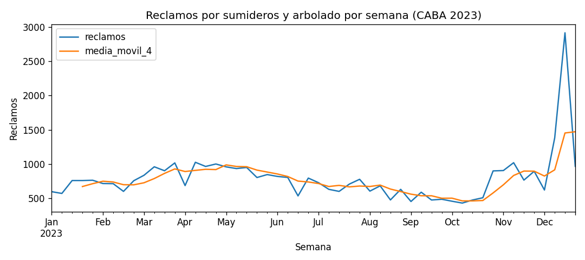
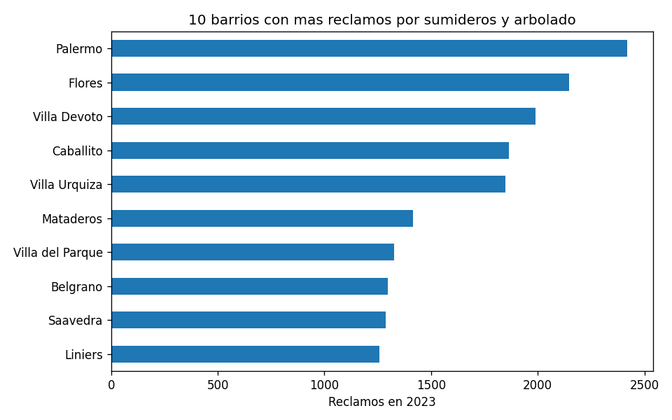

# Reporte de riesgo urbano - CABA - 2026-10-31

## 1. Resumen

Dia evaluado: **2026-09-14** (el de mayor lluvia prevista).

| Emergencia | Alerta | Atencion | Normal |
|---|---|---|---|
| 0 | 38 | 10 | 0 |

## 2. Pronostico (API OpenWeather)

| Fecha | Lluvia (mm) | Viento max (km/h) | Temperatura (C) |
|---|---|---|---|
| 2026-09-12 | 1.0 | 22 | 10.0 a 14.7 |
| 2026-09-13 | 5.5 | 43 | 6.0 a 10.8 |
| 2026-09-14 | 38.5 | 43 | 7.9 a 14.1 |
| 2026-09-15 | 0.0 | 17 | 9.4 a 19.8 |
| 2026-09-16 | 0.0 | 21 | 11.0 a 15.2 |

## 3. Avisos oficiales (scraping)

El scraping esta desactivado o no se pudo realizar en esta corrida.

## 4. Indice de riesgo por barrio (los 10 mas altos)

| Barrio | Nivel | Indice | Peligro | Factor | Motivos |
|---|---|---|---|---|---|
| Palermo | alerta | 66.4 | 53.1 | 1.25 | Lluvia prevista: 38 mm; Viento previsto: 43 km/h; Lluvia y viento juntos: riesgo de arboles caidos; Historial: 2419 reclamos por sumideros y arbolado en 2023 (factor 1.25) |
| Flores | alerta | 65.9 | 53.1 | 1.24 | Lluvia prevista: 38 mm; Viento previsto: 43 km/h; Lluvia y viento juntos: riesgo de arboles caidos; Historial: 2147 reclamos por sumideros y arbolado en 2023 (factor 1.24) |
| Villa Devoto | alerta | 65.2 | 53.1 | 1.23 | Lluvia prevista: 38 mm; Viento previsto: 43 km/h; Lluvia y viento juntos: riesgo de arboles caidos; Historial: 1990 reclamos por sumideros y arbolado en 2023 (factor 1.23) |
| Caballito | alerta | 64.7 | 53.1 | 1.22 | Lluvia prevista: 38 mm; Viento previsto: 43 km/h; Lluvia y viento juntos: riesgo de arboles caidos; Historial: 1865 reclamos por sumideros y arbolado en 2023 (factor 1.22) |
| Villa Urquiza | alerta | 64.2 | 53.1 | 1.21 | Lluvia prevista: 38 mm; Viento previsto: 43 km/h; Lluvia y viento juntos: riesgo de arboles caidos; Historial: 1848 reclamos por sumideros y arbolado en 2023 (factor 1.21) |
| Mataderos | alerta | 63.6 | 53.1 | 1.20 | Lluvia prevista: 38 mm; Viento previsto: 43 km/h; Lluvia y viento juntos: riesgo de arboles caidos; Historial: 1417 reclamos por sumideros y arbolado en 2023 (factor 1.20) |
| Villa del Parque | alerta | 63.0 | 53.1 | 1.19 | Lluvia prevista: 38 mm; Viento previsto: 43 km/h; Lluvia y viento juntos: riesgo de arboles caidos; Historial: 1326 reclamos por sumideros y arbolado en 2023 (factor 1.19) |
| Belgrano | alerta | 62.5 | 53.1 | 1.18 | Lluvia prevista: 38 mm; Viento previsto: 43 km/h; Lluvia y viento juntos: riesgo de arboles caidos; Historial: 1296 reclamos por sumideros y arbolado en 2023 (factor 1.18) |
| Saavedra | alerta | 61.9 | 53.1 | 1.17 | Lluvia prevista: 38 mm; Viento previsto: 43 km/h; Lluvia y viento juntos: riesgo de arboles caidos; Historial: 1288 reclamos por sumideros y arbolado en 2023 (factor 1.17) |
| Liniers | alerta | 61.3 | 53.1 | 1.15 | Lluvia prevista: 38 mm; Viento previsto: 43 km/h; Lluvia y viento juntos: riesgo de arboles caidos; Historial: 1259 reclamos por sumideros y arbolado en 2023 (factor 1.15) |

## 5. Contexto historico (SUACI 2023, ETL con Pandas)

Barrios con mas reclamos por sumideros, calles anegadas y arbolado:

| Barrio | Reclamos 2023 | Del total | Factor |
|---|---|---|---|
| Palermo | 2419 | 5.89% | 1.25 |
| Flores | 2147 | 5.23% | 1.24 |
| Villa Devoto | 1990 | 4.85% | 1.228 |
| Caballito | 1865 | 4.54% | 1.218 |
| Villa Urquiza | 1848 | 4.5% | 1.208 |

## 6. Como se calcula

Indice = peligro meteorologico (lluvia y viento previstos, 0 a 100) x factor de vulnerabilidad del barrio (0.75 a 1.25, segun sus reclamos historicos). Cortes: atencion 20, alerta 45, emergencia 70. Detalle en el README.
